
<a href="README.md">Deutsch</a> · <b>English</b> · <a href="README.it.md">Italiano</a>

# Mihaela Aghirculesei

### Fullstack Developer · Python / FastAPI · Angular · TypeScript

I build web applications end-to-end – from async FastAPI back ends to accessible Angular front ends, backed by tests and CI quality gates.

🟢 **Open to full-time roles** · Wolfsburg · Remote (EU) · EU citizen, no sponsorship needed

<table>
  <tr>
    <td align="center" width="50%"><a href="https://alina-moments-photography.vercel.app"><b>Client project live</b></a> built on my own, from architecture to deployment</td>
    <td align="center" width="50%"><a href="https://www.npmjs.com/package/bfsg-scanner"><b>npm package</b></a> published with SLSA build provenance</td>
  </tr>
  <tr>
    <td align="center" width="50%"><a href="https://github.com/maplibre/maplibre-gl-js/pull/8766"><b>Open source</b></a> contribution to MapLibre GL JS, merged</td>
    <td align="center" width="50%"><a href="https://mihaelaaghirculesei.github.io/bfsg-scanner/"><b>Accessibility</b></a> WCAG 2.1 AA / BFSG as a CI gate</td>
  </tr>
</table>

---

## 👩‍💻 About Me

Software developer with a bachelor's degree in economics (business informatics) and an AZAV-certified qualification. I build web applications end-to-end: **back ends with Python/FastAPI, PostgreSQL and Redis** and **front ends with Angular & TypeScript** (also Next.js / React and Vue / Nuxt) – including tests, CI/CD and monitoring. Several applications are live in production – including a client website I built end-to-end, from architecture to deployment, on my own.

Before that, several years in **project coordination** on automotive and IT development projects: requirements management, Jira/DMS, release processes, and facilitating alignment meetings with up to 150 participants. I bring that dual perspective – delivery **and** coordination – to every team.

- 🗣️ Romanian & Italian (native) · German (fluent) · English B1 (reading/writing)
- ♿ Focus on accessibility (WCAG 2.1 AA / BFSG) and automated quality assurance
- 🤝 Open-source contribution: [MapLibre GL JS](https://github.com/maplibre/maplibre-gl-js) – docs note for Vite-based SSR frameworks (Nuxt, SvelteKit, Astro), [PR #8766](https://github.com/maplibre/maplibre-gl-js/pull/8766) merged

---

## 🎨 Featured Projects

### 🍽️ dineos · Real-time ordering system for restaurants 
A restaurant operating system built end-to-end on my own – back end, front end, infrastructure and deploy pipeline. Guests order and pay from a QR code at the table, the kitchen sees new orders instantly over WebSocket, and managers run tables, staff and the menu from a dashboard.

- **Real time:** WebSocket fan-out via Redis Pub/Sub (multi-instance), per-IP connection caps, heartbeat to reclaim dead sockets
- **Security:** JWT with refresh tokens and revocation, 4 roles, rate limiting – my own security review found a cross-tenant data leak, fixed and locked down with regression tests
- **Quality:** 376 back-end tests (pytest against real PostgreSQL + Redis in CI), `mypy --strict`, Ruff, coverage gate, 6 architecture decision records

**Tech:** Python • FastAPI • SQLAlchemy 2.0 (async) • Alembic • PostgreSQL • Redis • WebSocket • Stripe • Docker • OpenTelemetry • Prometheus • Grafana • Angular 21 • NgRx

🔒 Private repository (commercial product) · Code walkthrough on request

<b>Architecture, payments & operations</b>

 

- **Architecture:** async FastAPI back end layered Router → Service → Repository, SQLAlchemy 2.0 + asyncpg, 11 Alembic migrations, multi-tenant isolation by `restaurant_id`
- **Payments:** Stripe PaymentIntents with idempotency keys, a dead-letter queue for failed webhooks with retry/backoff (atomic via Lua script), audit log
- **Operations:** Docker, two-stage CD (auto-deploy to staging → promotion to production with smoke test and rollback), OpenTelemetry traces, Prometheus + Grafana, Sentry, k6 load tests

### 📦 [bfsg-scanner](https://www.npmjs.com/package/bfsg-scanner) · Open-source npm package
A CLI that scans an entire website for WCAG 2.1 AA violations and maps every finding to the EN 301 549 / BFSG clause it breaches – producing a citeable conformance report in JSON/HTML/PDF. Built as a series of small, individually reviewed pull requests; the key architecture decisions each captured in an architecture decision record.

🌐 **Live sample report:** [mihaelaaghirculesei.github.io/bfsg-scanner](https://mihaelaaghirculesei.github.io/bfsg-scanner/)

- **Supply chain:** published to npm with SLSA build provenance; the release workflow publishes via OIDC trusted publishing – no long-lived tokens
- **CI gate:** exits non-zero at a configurable severity threshold, so a pipeline can block a merge on accessibility
- **Quality:** 167 tests, CI on Linux/Windows/macOS, a versioned JSON Schema for the report output, semantic exit codes

**Tech:** TypeScript • Node.js 22+ • Playwright • axe-core • Zod • Vitest • Biome • GitHub Actions

<b>Screenshot & engine</b>

 

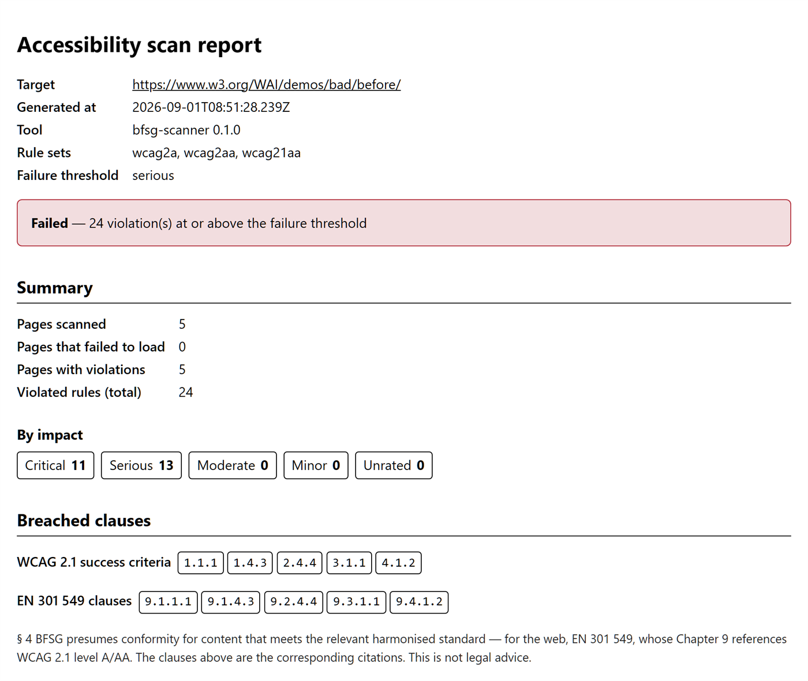

- **Engine:** sitemap + robots.txt-aware breadth-first crawl, concurrency pool with per-host rate limiting, real Chromium via Playwright + axe-core

### 📚 [normeon](https://github.com/MihaelaAghirculesei/normeon-german-technical-rag) · RAG for German technical documentation 
A RAG assistant for German-language technical documentation (requirement specs, UNECE regulations, manuals) that answers with verifiable source citations – and abstains rather than hallucinates.

- **Retrieval:** hybrid search combining vector search (pgvector, HNSW index), German full-text search and a trigram fallback, fused with Reciprocal Rank Fusion, then cross-encoder reranking
- **Generation:** citation validation (invented sources are dropped), a confidence gate before the LLM call, SSE streaming, per-request cost and latency logging
- **Evaluation:** a hand-written 50-question German eval set, LLM-as-judge calibrated against human scoring
- **Quality:** 356 tests (integration tests with Testcontainers), CI, swappable adapters for embeddings, LLM and reranker

**Tech:** Python • FastAPI • PostgreSQL + pgvector • Alembic • Docker • Pytest • Testcontainers

### More projects

| Project | Highlights | Stack |
|:--|:--|:--|
| 📸 **[Alina Moments Photography](https://alina-moments-photography.vercel.app)** · Client project Portfolio website for a photographer, live | Built on my own from architecture to live deployment (over 400 commits, over 100 merged PRs), ≥95% test coverage, Lighthouse ≥95 (Accessibility), nonce-based CSP, 4 languages | Next.js 16 • React 19 • PostgreSQL |
| ⚡ **[ChargeHub](https://github.com/MihaelaAghirculesei/ChargeHub)** · [Demo](https://charge-hub-one.vercel.app/de) EV charging infrastructure dashboard | Nitro BFF in front of the Open Charge Map API, LLM free-text search with structured output, ~92% coverage gate, axe-core as a blocking CI gate | Nuxt 4 • Vue 3 • TypeScript |
| 🎂 **[Birthday Reminder Pro](https://birthday-reminder-aghirculesei.pages.dev/)** Offline-first app for web and Android | Over 1,200 commits, over 2,000 unit and over 100 E2E tests, two-way Google Calendar sync, native Android notifications | Angular 22 • NgRx • Capacitor • Firebase |
| 📅 **[Intelligent Family Calendar](https://github.com/MihaelaAghirculesei/intelligent-family-calendar)** · [Demo](https://mihaelaaghirculesei.github.io/intelligent-family-calendar/) Weekly planner for families | Angular 17 → 22 with one commit per major version, zoneless, 125 Playwright E2E tests on Chromium, Firefox and WebKit, WCAG 2.2 AA | Angular 22 • Angular CDK • Playwright |
| 🔒 **[SecureNotes Lab](https://github.com/MihaelaAghirculesei/secure-notes-lab)** Security showcase | Built twice: 4 OWASP Top 10:2025 vulnerabilities plus CSRF introduced, documented and fixed, fixes proven with regression tests | Python • Flask • Bandit |
| 🐍 **[Todo API](https://github.com/MihaelaAghirculesei/todo-api)** · [Live](https://todo-frontend-aghirculesei.onrender.com) Team project (2 developers) | My contribution: the complete back end – Router → Service → Repository, 25/25 tests, API designed so the React front end could be built independently | FastAPI • SQLAlchemy 2.1 |

*Training projects (AZAV-certified qualification, Developer Akademie):*

| Project | Highlights | Stack |
|:--|:--|:--|
| 💡 **[Pokédex](https://pokedex-aghirculesei.pages.dev/)** | Offline-first PWA, 242 unit and 21 E2E tests at 100% coverage, Lighthouse CI | TypeScript • Vite • Vitest |
| 🔥 **[Join Kanban Board](https://join-aghirculesei.pages.dev/)** Team project (5 developers) | Continued my fork on my own: Angular 17 → 22, 17 emulator tests for the Firestore rules, CodeQL, npm audit from 97 findings to 0 | Angular 22 • Firebase |
| 🚀 **[El Pollo Loco](https://el-pollo-loco-aghirculesei.pages.dev/)** | 2D jump-and-run with no game framework: 20 object-oriented classes, pixel-perfect collision detection, ~60 FPS | HTML5 Canvas • JavaScript |

<b>📸 View screenshots</b>

 

<table>
  <tr>
    <td width="33%" align="center"><a href="https://alina-moments-photography.vercel.app">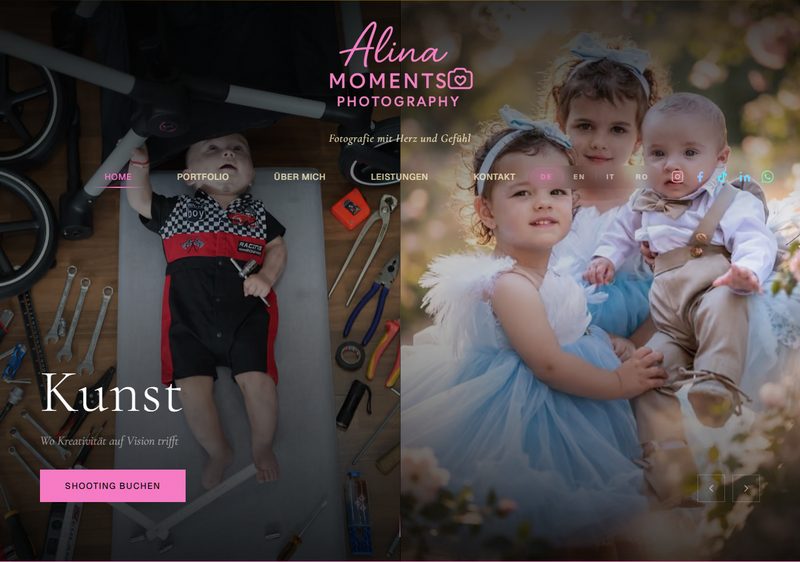</a> Alina Moments Photography</td>
    <td width="33%" align="center"><a href="https://charge-hub-one.vercel.app/de">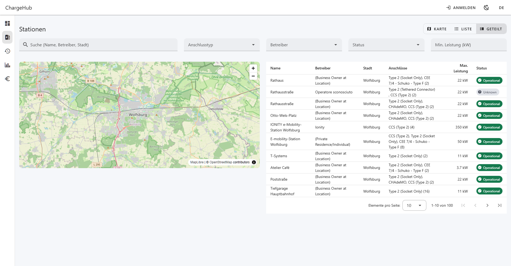</a> ChargeHub</td>
    <td width="33%" align="center"><a href="https://birthday-reminder-aghirculesei.pages.dev/">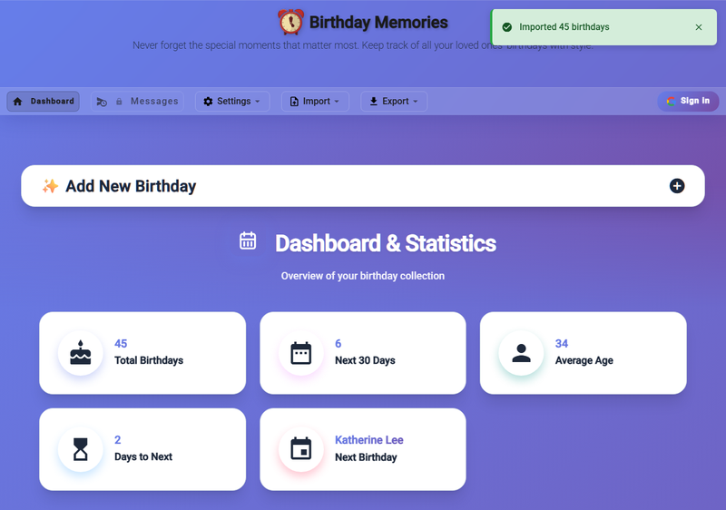</a> Birthday Reminder Pro</td>
  </tr>
  <tr>
    <td width="33%" align="center"><a href="https://mihaelaaghirculesei.github.io/intelligent-family-calendar/">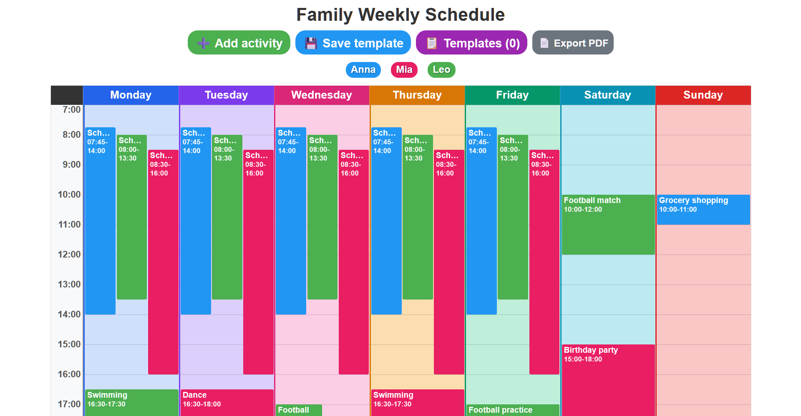</a> Intelligent Family Calendar</td>
    <td width="33%" align="center"><a href="https://github.com/MihaelaAghirculesei/secure-notes-lab">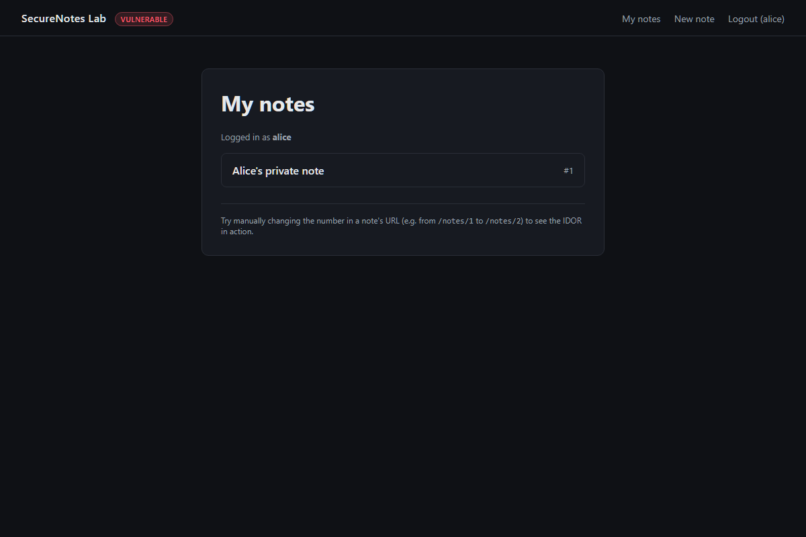</a> SecureNotes Lab</td>
    <td width="33%" align="center"><a href="https://todo-frontend-aghirculesei.onrender.com">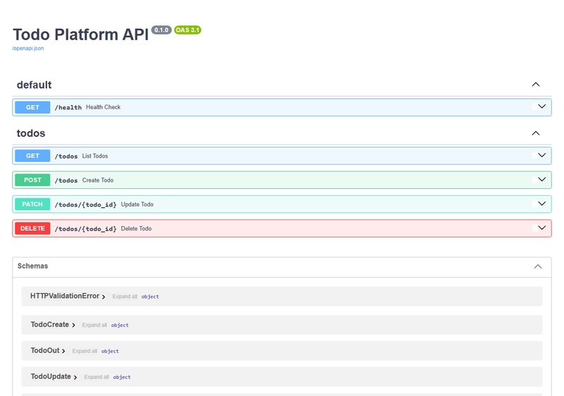</a> Todo API</td>
  </tr>
  <tr>
    <td width="33%" align="center"><a href="https://pokedex-aghirculesei.pages.dev/">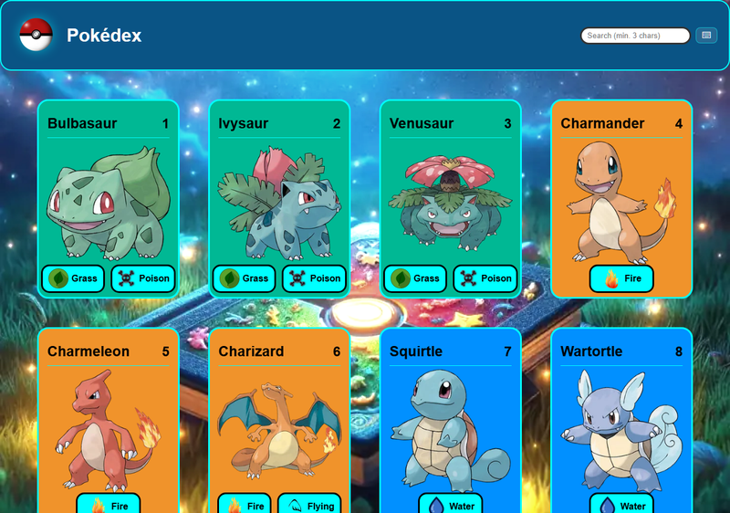</a> Pokédex</td>
    <td width="33%" align="center"><a href="https://join-aghirculesei.pages.dev/">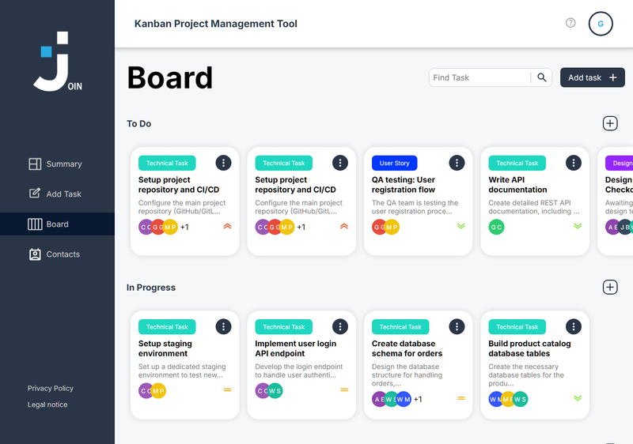</a> Join Kanban Board</td>
    <td width="33%" align="center"><a href="https://el-pollo-loco-aghirculesei.pages.dev/">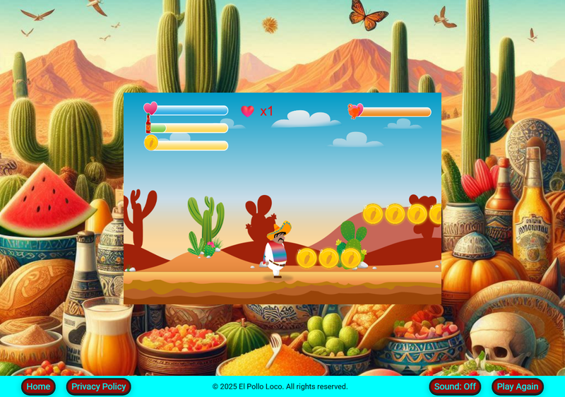</a> El Pollo Loco</td>
  </tr>
</table>

---

## 🛠️ Tech Stack

**Languages**

**Frontend**

**Mobile & PWA**

**Back end & Data**

**Testing & Quality**

**Tools & Infrastructure**

---

## 💼 Background

**Freelance Web & App Development** — Self-employed · since 10/2025
End-to-end development of web applications – from requirements gathering to deployment, focusing on appointment-booking systems and automated communication solutions.

**AZAV-certified Software Developer Qualification** — Developer Akademie GmbH · 10/2024 – 10/2025
18 modules, 12+ projects – several as part of SCRUM/Kanban teams. Focus: Angular, TypeScript, REST APIs, Firebase, test automation, UI/UX (Figma).

**Project Coordination – Automotive & IT** — Ferchau Automotive, jSERVICE · 2023 – 2024
Requirements management, work-package and schedule control in Jira/DMS, coordination of international release processes for driver-assistance systems, facilitation of alignment meetings with up to 150 participants.

**Bachelor's in Economics (Business Informatics)** — George Bacovia University, Bacău (RO)
Original title: Economist licențiat, specialization Contabilitate și informatică de gestiune (Accounting and Management Information Systems). Recognized by KMK/ZAB as equivalent to a German bachelor's degree.

---

## 📊 GitHub Activity

<picture>
  <source media="(max-width: 600px)" srcset="imgs/year-activity-mobile.png">
  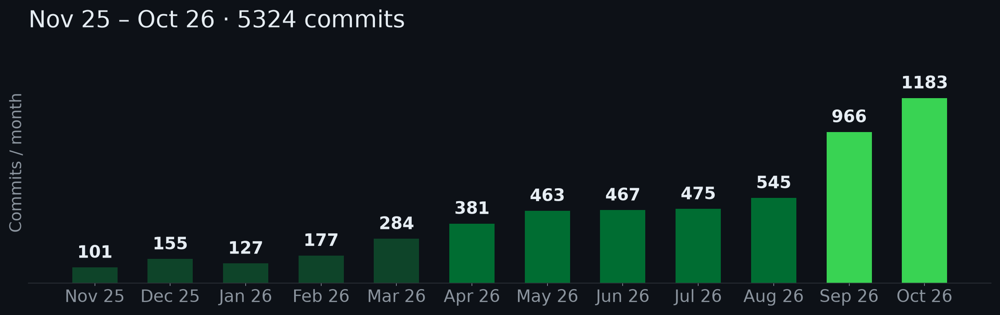
</picture>

---

## 🌍 Availability

- **Roles:** Fullstack Developer (Python/FastAPI + Angular) · Backend Developer (Python/FastAPI) · Frontend Developer (Angular / TypeScript)
- **Location:** Wolfsburg · remote within the EU
- **Languages:** Romanian & Italian (native) · Fluent German (all professional experience in German) · English B1 (reading/writing), A2 (speaking)
- 🇪🇺 **EU citizenship** (Romania & Italy) – full right to work in Germany and the entire EU, no visa, no sponsorship.

---

## 📫 Let's Connect

