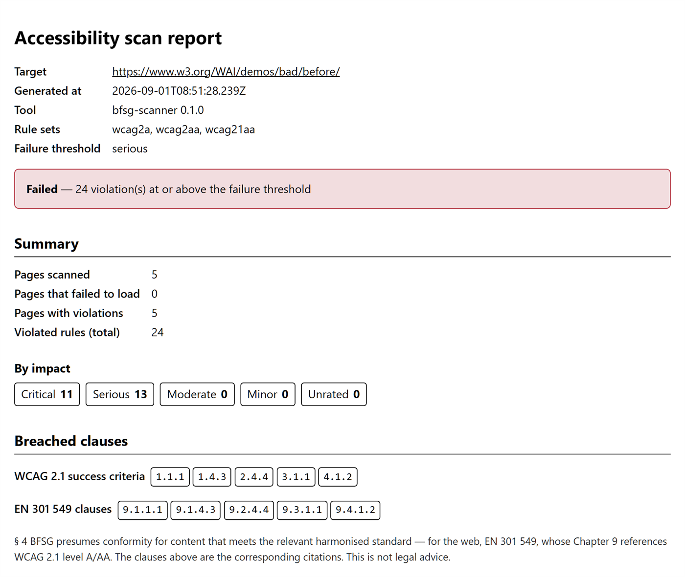
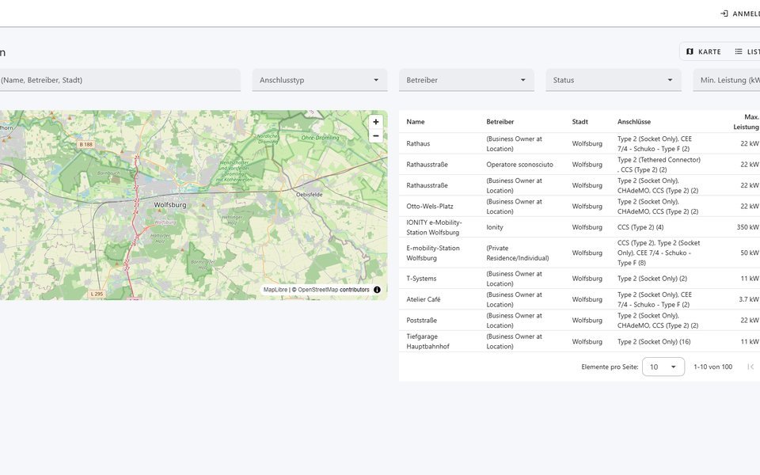
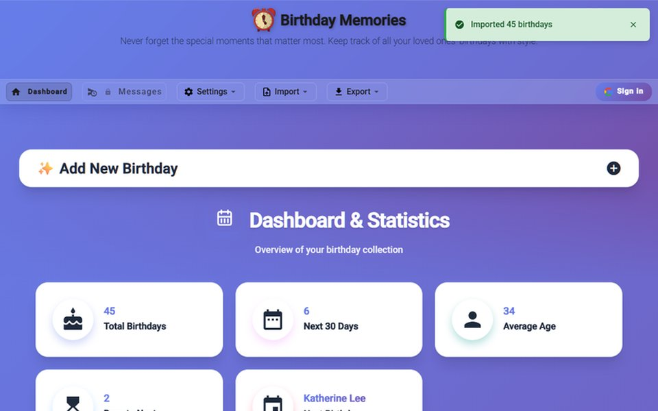
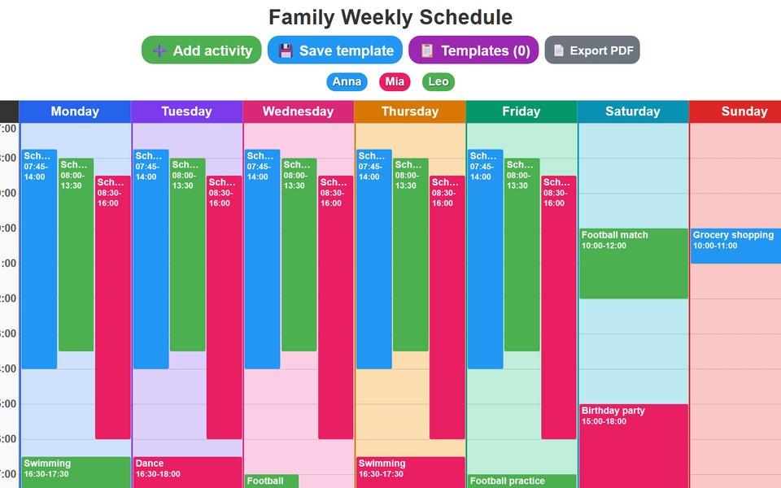
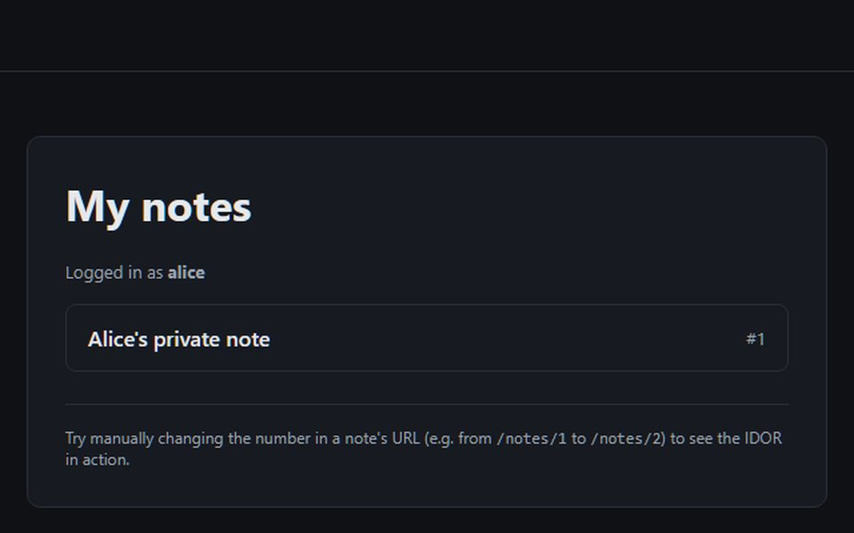
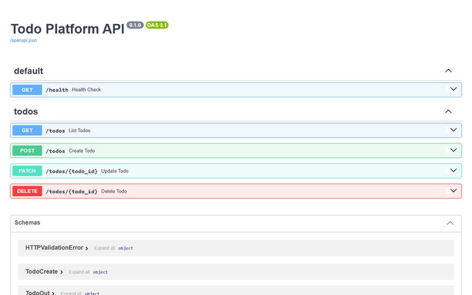
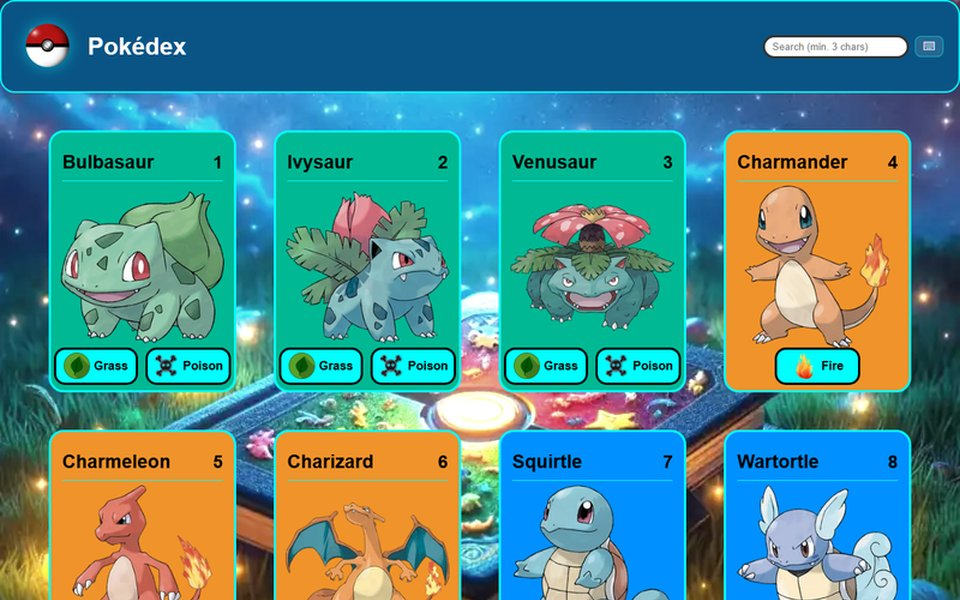
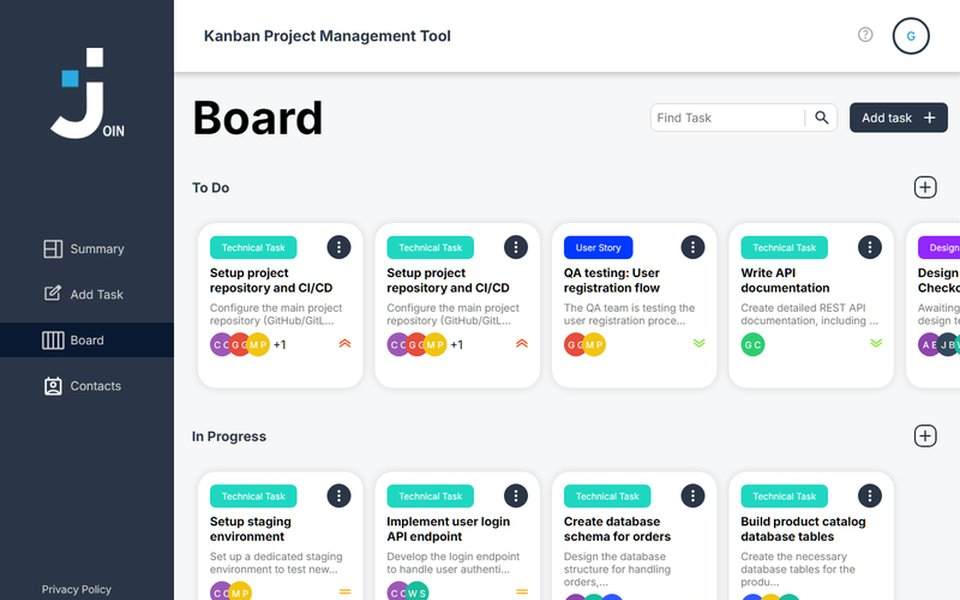
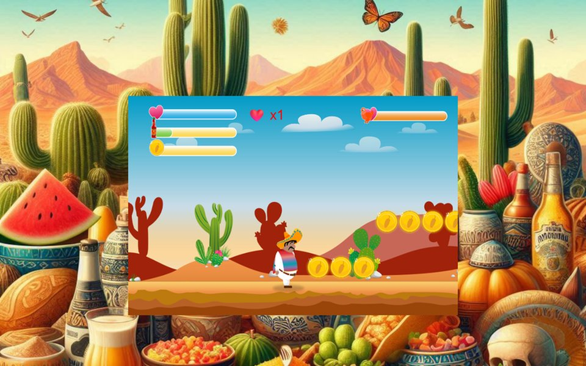
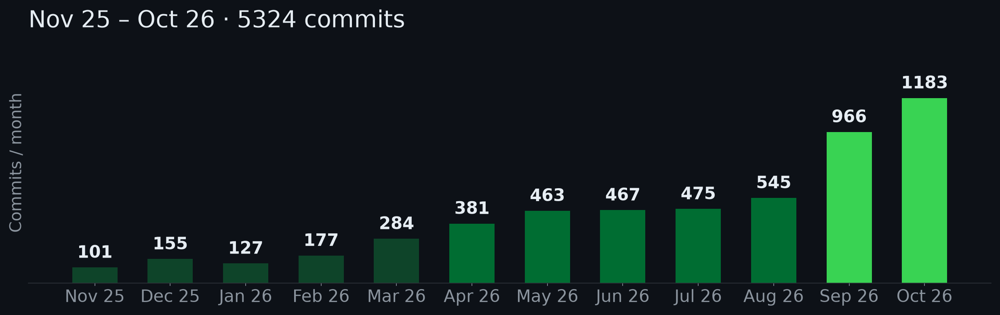

<a href="README.md">Deutsch</a> · <a href="README.en.md">English</a> · <b>Italiano</b>

# Mihaela Aghirculesei

### Sviluppatrice Fullstack · Python / FastAPI · Angular · TypeScript

Realizzo applicazioni web end-to-end – dal backend FastAPI asincrono al frontend Angular accessibile, con test e quality gate in CI.

🟢 **Disponibile per un'assunzione** · Wolfsburg · Remote (UE) · cittadina UE, nessuna sponsorizzazione necessaria

<table>
  <tr>
    <td align="center" width="50%"><a href="https://alina-moments-photography.vercel.app"><b>Progetto cliente live</b></a> realizzato in autonomia, dall'architettura al deployment</td>
    <td align="center" width="50%"><a href="https://www.npmjs.com/package/bfsg-scanner"><b>Pacchetto npm</b></a> pubblicato con SLSA build provenance</td>
  </tr>
  <tr>
    <td align="center" width="50%"><a href="https://github.com/maplibre/maplibre-gl-js/pull/8766"><b>Open source</b></a> contributo a MapLibre GL JS, mergiato</td>
    <td align="center" width="50%"><a href="https://mihaelaaghirculesei.github.io/bfsg-scanner/"><b>Accessibilità</b></a> WCAG 2.1 AA / BFSG come gate CI</td>
  </tr>
</table>

---

## 👩‍💻 Chi sono

Sviluppatrice software con laurea triennale in Scienze economiche (Informatica per l'economia) e una qualifica certificata AZAV. Realizzo applicazioni web end-to-end: **backend con Python/FastAPI, PostgreSQL e Redis** e **frontend con Angular & TypeScript** (anche Next.js / React e Vue / Nuxt) – inclusi test, CI/CD e monitoring. Diverse applicazioni sono in produzione – tra cui un sito per un cliente che ho realizzato dall'architettura al deployment, in autonomia.

In precedenza, **coordinamento di progetto** in ambito automotive e IT: gestione dei requisiti, Jira/DMS, processi di rilascio e moderazione di riunioni di allineamento con fino a 150 partecipanti. Porto in ogni team questa doppia prospettiva – realizzazione **e** coordinamento.

- ♿ Focus su accessibilità (WCAG 2.1 AA / BFSG) e controllo qualità automatizzato
- 🤝 Contributo open source: [MapLibre GL JS](https://github.com/maplibre/maplibre-gl-js) – nota nella documentazione per i framework SSR basati su Vite (Nuxt, SvelteKit, Astro), [PR #8766](https://github.com/maplibre/maplibre-gl-js/pull/8766) mergiata

---

## 🎨 Progetti in Evidenza

### 🍽️ dineos · Sistema di ordinazione in tempo reale per la ristorazione 
Un sistema operativo per ristoranti realizzato in autonomia end-to-end – backend, frontend, infrastruttura e pipeline di deploy. Gli ospiti ordinano e pagano da un QR code al tavolo, la cucina vede i nuovi ordini all'istante via WebSocket, i manager gestiscono tavoli, personale e menu da una dashboard.

- **Tempo reale:** fan-out WebSocket tramite Redis Pub/Sub (multi-istanza), limiti di connessione per IP, heartbeat per chiudere le connessioni morte
- **Sicurezza:** JWT con refresh token e revoca, 4 ruoli, rate limiting – in una security review interna ho trovato una fuga di dati tra tenant, corretta e blindata con test di regressione
- **Qualità:** 376 test backend (pytest su PostgreSQL + Redis reali in CI), `mypy --strict`, Ruff, gate di coverage, 6 architecture decision record

**Tech:** Python • FastAPI • SQLAlchemy 2.0 (async) • Alembic • PostgreSQL • Redis • WebSocket • Stripe • Docker • OpenTelemetry • Prometheus • Grafana • Angular 21 • NgRx

🔒 Repository privato (prodotto commerciale) · Walkthrough del codice su richiesta

<b>Architettura, pagamenti e operatività</b>

 

- **Architettura:** backend FastAPI asincrono a strati Router → Service → Repository, SQLAlchemy 2.0 + asyncpg, 11 migrazioni Alembic, isolamento multi-tenant per `restaurant_id`
- **Pagamenti:** Stripe PaymentIntents con chiavi di idempotenza, dead-letter queue per i webhook falliti con retry/backoff (atomica via script Lua), audit log
- **Operatività:** Docker, CD in due fasi (deploy automatico su staging → promozione in produzione con smoke test e rollback), tracce OpenTelemetry, Prometheus + Grafana, Sentry, load test con k6

### 📦 [bfsg-scanner](https://www.npmjs.com/package/bfsg-scanner) · Pacchetto npm open-source
CLI che analizza un intero sito web per violazioni WCAG 2.1 AA e mappa ogni riscontro alla clausola EN 301 549 / BFSG che infrange – producendo un report di conformità citabile in JSON/HTML/PDF. Costruito con una serie di pull request piccole, revisionate singolarmente; le decisioni architetturali chiave documentate ciascuna in un architecture decision record.

🌐 **Report di esempio live:** [mihaelaaghirculesei.github.io/bfsg-scanner](https://mihaelaaghirculesei.github.io/bfsg-scanner/)

- **Supply chain:** pubblicato su npm con SLSA build provenance; il workflow di release pubblica tramite OIDC trusted publishing – nessun token a lunga durata
- **CI gate:** esce con codice ≠ 0 oltre una soglia di severità configurabile, così una pipeline può bloccare il merge sull'accessibilità
- **Qualità:** 167 test, CI su Linux/Windows/macOS, JSON Schema versionato per l'output del report, exit code semantici

**Tech:** TypeScript • Node.js 22+ • Playwright • axe-core • Zod • Vitest • Biome • GitHub Actions

<b>Screenshot ed engine</b>

 

- **Engine:** crawl breadth-first che rispetta sitemap e robots.txt, pool di concorrenza con rate limit per host, Chromium reale via Playwright + axe-core

### 📚 [normeon](https://github.com/MihaelaAghirculesei/normeon-german-technical-rag) · RAG per documentazione tecnica tedesca
Assistente RAG per documentazione tecnica in lingua tedesca (capitolati, regolamenti UNECE, manuali) che risponde con citazioni verificabili delle fonti – e preferisce astenersi piuttosto che inventare.

- **Retrieval:** ricerca ibrida che combina ricerca vettoriale (pgvector, indice HNSW), full-text search tedesca e fallback a trigrammi, fusi con Reciprocal Rank Fusion, poi reranking con cross-encoder
- **Generazione:** validazione delle citazioni (le fonti inventate vengono scartate), gate di confidenza prima della chiamata all'LLM, streaming SSE, log di costi e latenza per ogni richiesta
- **Valutazione:** eval set tedesco di 50 domande scritto a mano, LLM-as-judge calibrato su valutazioni umane
- **Qualità:** oltre 700 test in CI (backend con Testcontainers, suite di sicurezza dedicata, frontend), adapter intercambiabili per embedding, LLM e reranker; frontend Angular con tipi generati da OpenAPI

**Tech:** Python • FastAPI • PostgreSQL + pgvector • Alembic • Docker • Pytest • Testcontainers • Angular 22 • Vitest

### Altri progetti

| Progetto | In evidenza | Stack |
|:--|:--|:--|
| 📸 **[Alina Moments Photography](https://alina-moments-photography.vercel.app)** · Progetto cliente Sito portfolio per una fotografa, live | Realizzato in autonomia dall'architettura al deployment live (oltre 400 commit, oltre 100 PR mergiate), copertura test ≥95%, Lighthouse ≥95 (Accessibility), CSP basata su nonce, 4 lingue | Next.js 16 • React 19 • PostgreSQL |
| ⚡ **[ChargeHub](https://github.com/MihaelaAghirculesei/ChargeHub)** · [Demo](https://charge-hub-one.vercel.app/de) Dashboard per infrastruttura di ricarica EV | BFF Nitro davanti all'API di Open Charge Map, ricerca a testo libero via LLM con structured output, gate di coverage ~92%, axe-core come gate CI bloccante | Nuxt 4 • Vue 3 • TypeScript |
| 🎂 **[Birthday Reminder Pro](https://birthday-reminder-aghirculesei.pages.dev/)** App offline-first per web e Android | Oltre 1.200 commit, oltre 2.000 unit test e oltre 100 test E2E, sincronizzazione bidirezionale con Google Calendar, notifiche native Android | Angular 22 • NgRx • Capacitor • Firebase |
| 📅 **[Intelligent Family Calendar](https://github.com/MihaelaAghirculesei/intelligent-family-calendar)** · [Demo](https://mihaelaaghirculesei.github.io/intelligent-family-calendar/) Planner settimanale per famiglie | Angular 17 → 22 con un commit per ogni versione major, zoneless, 125 test E2E Playwright su Chromium, Firefox e WebKit, WCAG 2.2 AA | Angular 22 • Angular CDK • Playwright |
| 🔒 **[SecureNotes Lab](https://github.com/MihaelaAghirculesei/secure-notes-lab)** Vetrina di sicurezza | Costruita due volte: 4 vulnerabilità OWASP Top 10:2025 più CSRF introdotte, documentate e corrette, fix dimostrati da test di regressione | Python • Flask • Bandit |
| 🐍 **[Todo API](https://github.com/MihaelaAghirculesei/todo-api)** · [Live](https://todo-frontend-aghirculesei.onrender.com) Progetto in team (2 sviluppatori) | Il mio contributo: l'intero backend – Router → Service → Repository, 25/25 test, API progettata perché il frontend React potesse nascere in autonomia | FastAPI • SQLAlchemy 2.1 |

*Progetti formativi (qualificazione certificata AZAV, Developer Akademie):*

| Progetto | In evidenza | Stack |
|:--|:--|:--|
| 💡 **[Pokédex](https://pokedex-aghirculesei.pages.dev/)** | PWA offline-first, 242 unit test e 21 test E2E al 100% di coverage, Lighthouse CI | TypeScript • Vite • Vitest |
| 🔥 **[Join Kanban Board](https://join-aghirculesei.pages.dev/)** Progetto in team (5 sviluppatori) | Fork portato avanti da sola: Angular 17 → 22, 17 test sull'emulatore per le regole Firestore, CodeQL, npm audit da 97 a 0 segnalazioni | Angular 22 • Firebase |
| 🚀 **[El Pollo Loco](https://el-pollo-loco-aghirculesei.pages.dev/)** | Jump-and-run 2D senza framework di gioco: 20 classi orientate agli oggetti, rilevamento collisioni pixel-perfect, ~60 FPS | HTML5 Canvas • JavaScript |

<b>📸 Guarda gli screenshot</b>

 

<table>
  <tr>
    <td width="33%" align="center" valign="top"> Alina Moments Photography</td>
    <td width="33%" align="center" valign="top"> ChargeHub</td>
    <td width="33%" align="center" valign="top"> Birthday Reminder Pro</td>
  </tr>
  <tr>
    <td width="33%" align="center" valign="top"> Intelligent Family Calendar</td>
    <td width="33%" align="center" valign="top"> SecureNotes Lab</td>
    <td width="33%" align="center" valign="top"> Todo API</td>
  </tr>
  <tr>
    <td width="33%" align="center" valign="top"> Pokédex</td>
    <td width="33%" align="center" valign="top"> Join Kanban Board</td>
    <td width="33%" align="center" valign="top"> El Pollo Loco</td>
  </tr>
</table>

---

## 🛠️ Stack tecnologico

**Linguaggi**

**Frontend**

**Mobile & PWA**

**Backend & Dati**

**Testing & Qualità**

**Strumenti & Infrastruttura**

---

## 💼 Percorso

**Sviluppo web & app freelance** — Libera professionista · da 10/2025 
Sviluppo end-to-end di applicazioni web – dalla raccolta dei requisiti al deployment, con focus su sistemi di prenotazione appuntamenti e soluzioni di comunicazione automatizzate.

**Qualifica certificata AZAV come sviluppatrice software** — Developer Akademie GmbH · 10/2024 – 10/2025 
18 moduli, oltre 12 progetti – diversi in team secondo SCRUM/Kanban. Focus: Angular, TypeScript, API REST, Firebase, automazione dei test, UI/UX (Figma).

**Coordinamento di progetto – Automotive & IT** — Ferchau Automotive, jSERVICE · 2023 – 2024 
Gestione dei requisiti, controllo dei work package e delle scadenze in Jira/DMS, coordinamento dei processi di rilascio internazionali per i sistemi di assistenza alla guida, moderazione di riunioni di allineamento con fino a 150 partecipanti.

**Laurea triennale in Scienze economiche (Informatica per l'economia)** — Università George Bacovia, Bacău (RO) 
Titolo originale: Economist licențiat, specializzazione Contabilitate și informatică de gestiune (Contabilità e informatica gestionale). Riconosciuto da KMK/ZAB come equivalente a una laurea triennale tedesca.

---

## 📊 Attività su GitHub

<picture>
  <source media="(max-width: 600px)" srcset="imgs/year-activity-mobile.png">
  
</picture>

---

## 🌍 Disponibilità

- **Ruoli:** Sviluppatrice Fullstack (Python/FastAPI + Angular) · Sviluppatrice Backend (Python/FastAPI) · Sviluppatrice Frontend (Angular / TypeScript)
- **Sede:** Wolfsburg · da remoto nell'UE
- **Lingue:** Rumeno & Italiano (madrelingua) · Tedesco fluente (tutta l'esperienza professionale in tedesco) · Inglese B1 (lettura/scrittura), A2 (parlato)
- 🇪🇺 **Cittadinanza UE** (Romania & Italia) – pieno diritto di lavorare in Germania e in tutta l'UE, nessun visto, nessuna sponsorizzazione.

---

## 📫 Contatti

