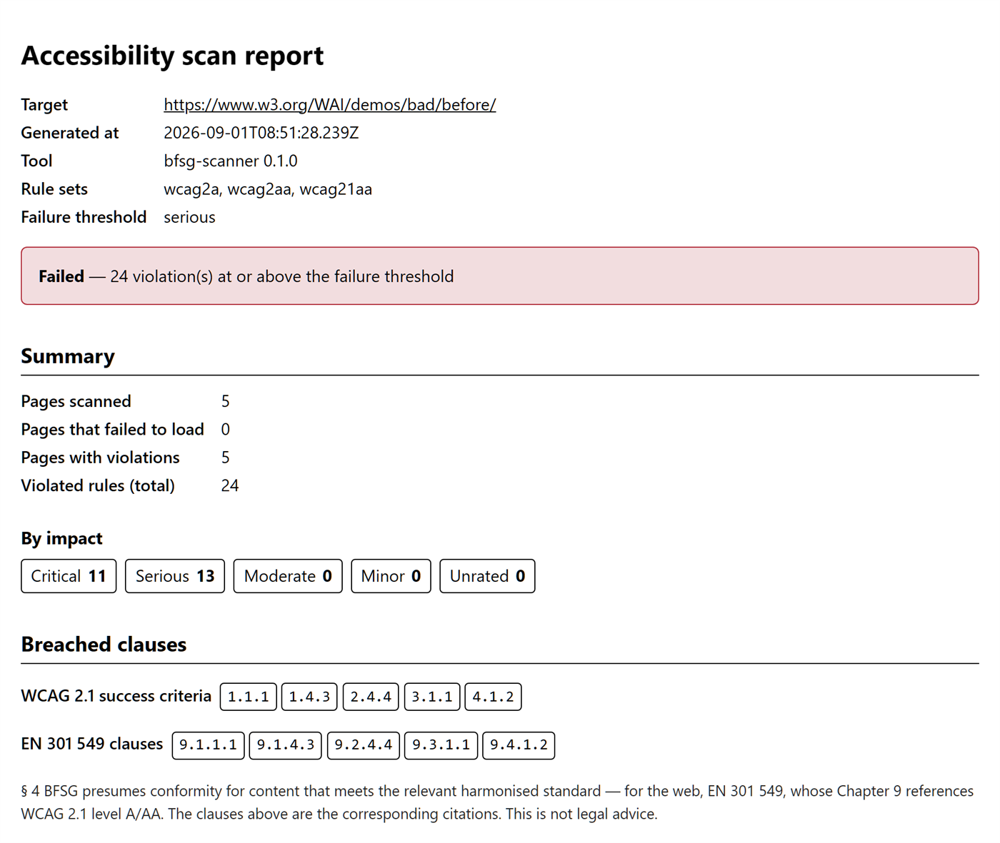
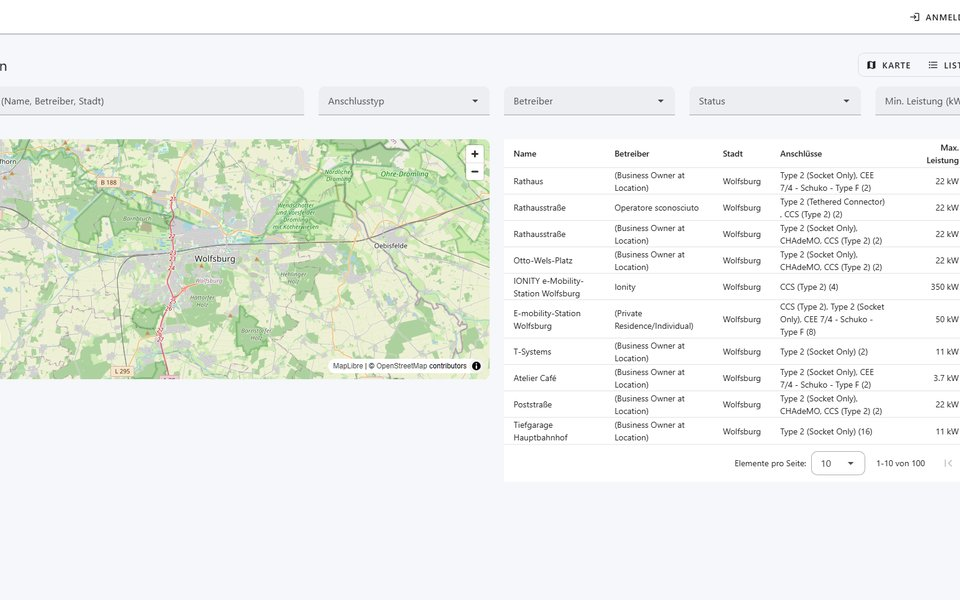
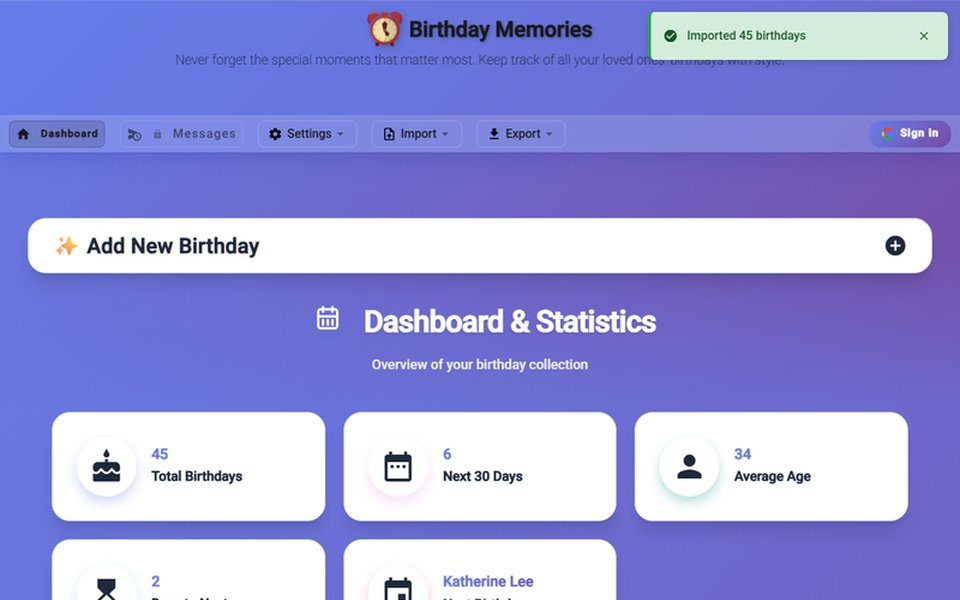
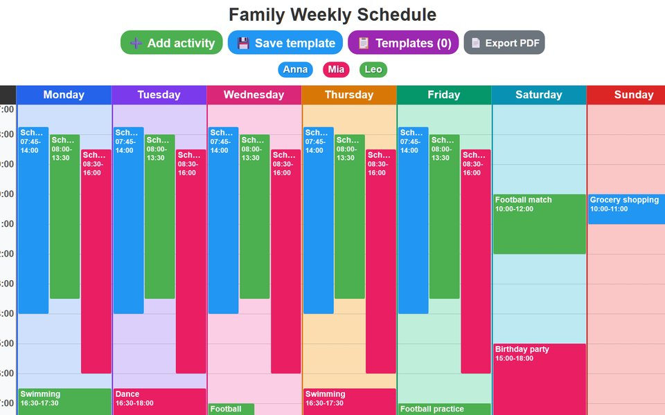
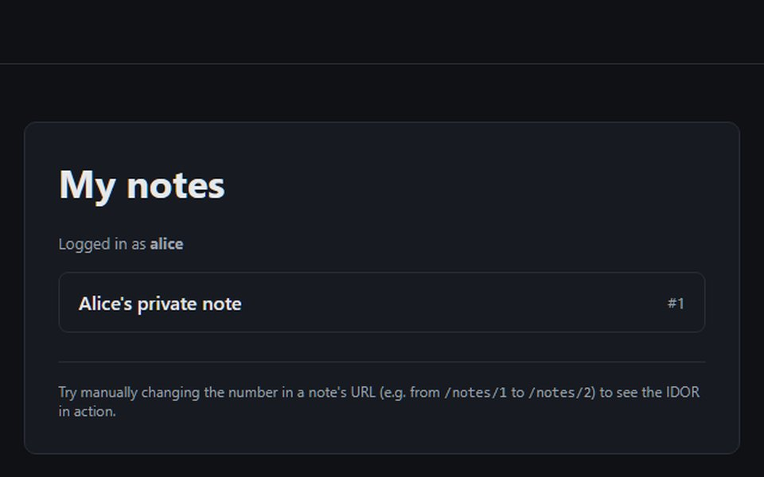
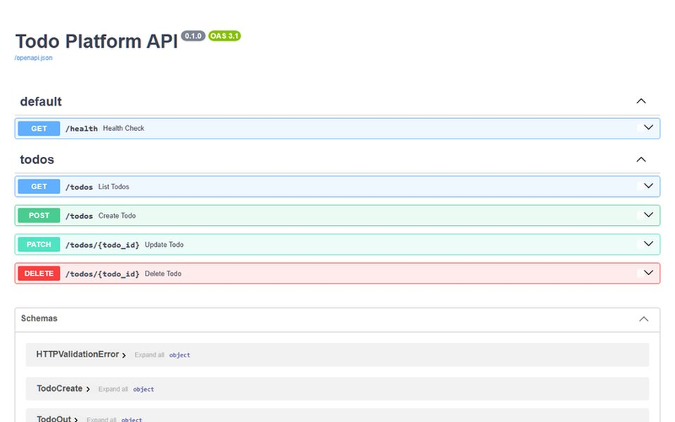
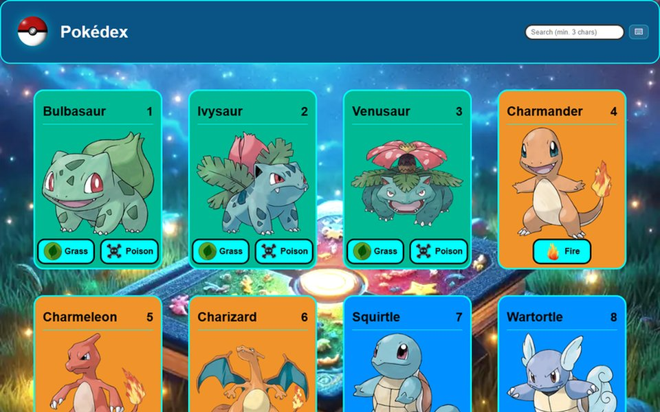
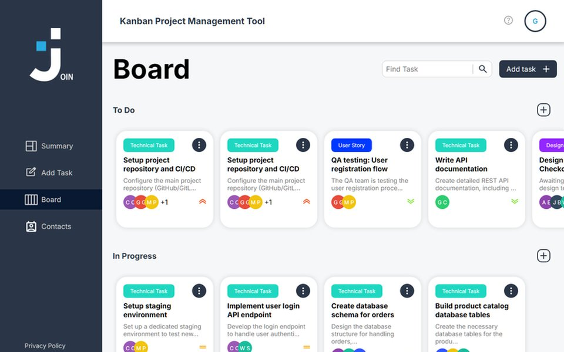
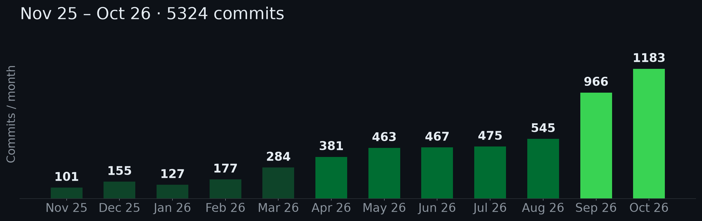

<b>Deutsch</b> · <a href="README.en.md">English</a> · <a href="README.it.md">Italiano</a>

# Mihaela Aghirculesei

### Fullstack-Entwicklerin · Python / FastAPI · Angular · TypeScript

Ich entwickle Web-Anwendungen end-to-end – vom asynchronen FastAPI-Backend bis zum barrierefreien Angular-Frontend, abgesichert durch Tests und CI-Qualitätsgates.

🟢 **Offen für Festanstellung** · Wolfsburg · Remote (EU) · EU-Staatsangehörigkeit, kein Sponsoring nötig

<table>
  <tr>
    <td align="center" width="50%"><a href="https://alina-moments-photography.vercel.app"><b>Kundenprojekt live</b></a> eigenverantwortlich von der Architektur bis zum Deployment</td>
    <td align="center" width="50%"><a href="https://www.npmjs.com/package/bfsg-scanner"><b>npm-Paket</b></a> veröffentlicht mit SLSA-Build-Provenance</td>
  </tr>
  <tr>
    <td align="center" width="50%"><a href="https://github.com/maplibre/maplibre-gl-js/pull/8766"><b>Open Source</b></a> Beitrag zu MapLibre GL JS, gemergt</td>
    <td align="center" width="50%"><a href="https://mihaelaaghirculesei.github.io/bfsg-scanner/"><b>Barrierefreiheit</b></a> WCAG 2.1 AA / BFSG als CI-Gate</td>
  </tr>
</table>

---

## 👩‍💻 Über mich

Softwareentwicklerin mit Bachelor in Wirtschaftswissenschaften (Wirtschaftsinformatik) und AZAV-zertifizierter Qualifizierung. Ich entwickle Web-Anwendungen end-to-end: **Backends mit Python/FastAPI, PostgreSQL und Redis** und **Frontends mit Angular & TypeScript** (auch Next.js / React und Vue / Nuxt) – inklusive Tests, CI/CD und Monitoring. Mehrere Anwendungen laufen im Live-Betrieb – darunter eine Kundenwebsite, die ich eigenverantwortlich von der Architektur bis zum Deployment umgesetzt habe.

Davor **Projektkoordination** in Automotive- und IT-Entwicklungsprojekten: Anforderungsmanagement, Jira/DMS, Freigabeprozesse und Moderation von Abstimmungsrunden mit bis zu 150 Teilnehmenden. Diese Doppelperspektive – Umsetzung **und** Koordination – bringe ich in jedes Team ein.

- ♿ Schwerpunkt Barrierefreiheit (WCAG 2.1 AA / BFSG) und automatisierte Qualitätssicherung
- 🤝 Open-Source-Beitrag: [MapLibre GL JS](https://github.com/maplibre/maplibre-gl-js) – Doku-Hinweis für Vite-basierte SSR-Frameworks (Nuxt, SvelteKit, Astro), [PR #8766](https://github.com/maplibre/maplibre-gl-js/pull/8766) gemergt

---

## 🎨 Ausgewählte Projekte

### 🍽️ dineos · Echtzeit-Bestellsystem für die Gastronomie
Restaurant-Betriebssystem, allein end-to-end entwickelt – Backend, Frontend, Infrastruktur und Deploy-Pipeline. Gäste bestellen und bezahlen per QR-Code am Tisch, die Küche sieht neue Bestellungen sofort über WebSocket, Manager steuern Tische, Personal und Speisekarte über ein Dashboard.

- **Echtzeit:** WebSocket-Fan-out über Redis Pub/Sub (mehrere Instanzen), Verbindungslimits pro IP, Heartbeat für tote Verbindungen
- **Sicherheit:** JWT mit Refresh-Token und Revocation, 4 Rollen, Rate-Limiting – im eigenen Security-Review ein Cross-Tenant-Datenleck gefunden und mit Regressionstests geschlossen
- **Qualität:** über 380 Backend-Tests (pytest gegen echtes PostgreSQL + Redis in CI) und über 350 Frontend-Tests, `mypy --strict`, Ruff, Coverage-Gate, 7 Architecture Decision Records

**Tech:** Python • FastAPI • SQLAlchemy 2.0 (async) • Alembic • PostgreSQL • Redis • WebSocket • Stripe • Docker • OpenTelemetry • Prometheus • Grafana • Angular 21 • NgRx

🔒 Privates Repository (kommerzielles Produkt) · Code-Walkthrough auf Anfrage

<b>Architektur, Zahlungen & Betrieb</b>

 

- **Architektur:** asynchrones FastAPI-Backend mit Schichten Router → Service → Repository, SQLAlchemy 2.0 + asyncpg, 11 Alembic-Migrationen, Multi-Tenant-Isolation per `restaurant_id`
- **Zahlungen:** Stripe PaymentIntents mit Idempotency-Keys, Dead-Letter-Queue für fehlgeschlagene Webhooks mit Retry/Backoff (atomar per Lua-Skript), Audit-Log
- **Betrieb:** Docker, zweistufiges CD (Staging automatisch → Produktion per Promotion mit Smoke-Test und Rollback), OpenTelemetry-Traces, Prometheus + Grafana, Sentry, Lasttests mit k6

### 📦 [bfsg-scanner](https://www.npmjs.com/package/bfsg-scanner) · Open-Source npm-Paket
Kommandozeilen-Tool, das eine komplette Website auf WCAG-2.1-AA-Verstöße prüft und jeden Fund der EN-301-549-/BFSG-Klausel zuordnet, gegen die er verstößt – als zitierfähigen Konformitätsbericht in JSON/HTML/PDF. Entwickelt in klein geschnittenen, einzeln reviewten Pull Requests; die zentralen Architekturentscheidungen jeweils mit einem Architecture Decision Record.

🌐 **Live-Beispielbericht:** [mihaelaaghirculesei.github.io/bfsg-scanner](https://mihaelaaghirculesei.github.io/bfsg-scanner/)

- **Supply-Chain:** auf npm veröffentlicht mit SLSA-Build-Provenance; der Release-Workflow publiziert über OIDC Trusted Publishing – keine langlebigen Tokens
- **CI-Gate:** Exit-Code ≠ 0 ab konfigurierbarer Schweregrad-Schwelle – so kann eine Pipeline den Merge auf Barrierefreiheit blockieren
- **Qualität:** 167 Tests, CI auf Linux/Windows/macOS, versioniertes JSON-Schema für die Bericht-Ausgabe, semantische Exit-Codes

**Tech:** TypeScript • Node.js 22+ • Playwright • axe-core • Zod • Vitest • Biome • GitHub Actions

<b>Screenshot & Engine</b>

 

- **Engine:** Sitemap- + robots.txt-bewusster Breadth-First-Crawl, Concurrency-Pool mit Per-Host-Rate-Limit, echtes Chromium via Playwright + axe-core

### 📚 [normeon](https://github.com/MihaelaAghirculesei/normeon-german-technical-rag) · RAG für deutsche technische Dokumentation
RAG-Assistent für deutschsprachige technische Dokumentation (Lastenhefte, UNECE-Regelungen, Handbücher), der mit überprüfbaren Quellenzitaten antwortet – und sich lieber enthält, als zu halluzinieren.

🌐 **Live-Demo:** [normeon.onrender.com](https://normeon.onrender.com) – „Als Gast ansehen“ · Free Tier: der erste Aufruf kann bis zu einer Minute dauern

- **Retrieval:** hybride Suche aus Vektorsuche (pgvector, HNSW-Index), deutscher Volltextsuche und Trigramm-Fallback, fusioniert per Reciprocal Rank Fusion, danach Cross-Encoder-Reranking
- **Generierung:** Zitatvalidierung (erfundene Quellen werden verworfen), Konfidenz-Gate vor dem LLM-Aufruf, Streaming per SSE, Kosten- und Latenz-Logging pro Anfrage
- **Evaluation:** handgeschriebenes deutsches Eval-Set mit 50 Fragen, LLM-as-Judge kalibriert gegen menschliche Bewertung
- **Qualität:** über 700 Tests in CI (Backend mit Testcontainers, eigene Security-Suite, Frontend), austauschbare Adapter für Embeddings, LLM und Reranker; Angular-Frontend mit aus OpenAPI generierten Typen

**Tech:** Python • FastAPI • PostgreSQL + pgvector • Alembic • Docker • Pytest • Testcontainers • Angular 22 • Vitest

### Weitere Projekte

| Projekt | Highlights | Stack |
|:--|:--|:--|
| 📸 **[Alina Moments Photography](https://alina-moments-photography.vercel.app)** · Kundenprojekt Portfolio-Website für eine Fotografin, live | Eigenverantwortlich von der Architektur bis zum Live-Deployment (über 400 Commits, über 100 gemergte PRs), ≥95 % Testabdeckung, Lighthouse ≥95 (Accessibility), Nonce-basierte CSP, 4 Sprachen | Next.js 16 • React 19 • PostgreSQL |
| ⚡ **[ChargeHub](https://github.com/MihaelaAghirculesei/ChargeHub)** · [Demo](https://charge-hub-one.vercel.app/de) Dashboard für EV-Ladeinfrastruktur | Nitro-BFF vor der Open-Charge-Map-API, LLM-Freitextsuche mit Structured Output, Coverage-Gate ~92 %, axe-core als blockierendes CI-Gate | Nuxt 4 • Vue 3 • TypeScript |
| 🎂 **[Birthday Reminder Pro](https://birthday-reminder-aghirculesei.pages.dev/)** Offline-First-App für Web und Android | Über 1.200 Commits, über 2.000 Unit- und über 100 E2E-Tests, bidirektionale Google-Calendar-Synchronisierung, native Android-Benachrichtigungen | Angular 22 • NgRx • Capacitor • Firebase |
| 📅 **[Intelligent Family Calendar](https://github.com/MihaelaAghirculesei/intelligent-family-calendar)** · [Demo](https://mihaelaaghirculesei.github.io/intelligent-family-calendar/) Wochenplaner für Familien | Angular 17 → 22 mit einem Commit pro Major-Version, Zoneless, 125 Playwright-E2E-Tests auf Chromium, Firefox und WebKit, WCAG 2.2 AA | Angular 22 • Angular CDK • Playwright |
| 🔒 **[SecureNotes Lab](https://github.com/MihaelaAghirculesei/secure-notes-lab)** Security-Showcase | Zweimal gebaut: 4 OWASP-Top-10:2025-Schwachstellen plus CSRF eingebaut, dokumentiert und behoben, Fixes mit Regressionstests bewiesen | Python • Flask • Bandit |
| 🐍 **[Todo API](https://github.com/MihaelaAghirculesei/todo-api)** · [Live](https://todo-frontend-aghirculesei.onrender.com) Teamprojekt (2 Entwickler) | Mein Beitrag: das komplette Backend – Router → Service → Repository, 25/25 Tests, API so entworfen, dass das React-Frontend unabhängig entstehen konnte | FastAPI • SQLAlchemy 2.1 |

*Ausbildungsprojekte (AZAV-zertifizierte Qualifizierung, Developer Akademie):*

| Projekt | Highlights | Stack |
|:--|:--|:--|
| 💡 **[Pokédex](https://pokedex-aghirculesei.pages.dev/)** | Offline-First-PWA, 242 Unit- und 21 E2E-Tests bei 100 % Coverage, Lighthouse CI | TypeScript • Vite • Vitest |
| 🔥 **[Join Kanban Board](https://join-aghirculesei.pages.dev/)** Teamprojekt (5 Entwickler) | Fork eigenständig weitergeführt: Angular 17 → 22, 17 Emulator-Tests für die Firestore-Regeln, CodeQL, npm audit von 97 auf 0 Befunde | Angular 22 • Firebase |
| 🚀 **[El Pollo Loco](https://el-pollo-loco-aghirculesei.pages.dev/)** | 2D-Jump-and-Run ohne Game-Framework: 20 objektorientierte Klassen, pixelgenaue Kollisionserkennung, ~60 FPS | HTML5 Canvas • JavaScript |

<b>📸 Screenshots ansehen</b>

 

<table>
  <tr>
    <td width="33%" align="center" valign="top"> Alina Moments Photography</td>
    <td width="33%" align="center" valign="top"> ChargeHub</td>
    <td width="33%" align="center" valign="top"> Birthday Reminder Pro</td>
  </tr>
  <tr>
    <td width="33%" align="center" valign="top"> Intelligent Family Calendar</td>
    <td width="33%" align="center" valign="top"> SecureNotes Lab</td>
    <td width="33%" align="center" valign="top"> Todo API</td>
  </tr>
  <tr>
    <td width="33%" align="center" valign="top"> Pokédex</td>
    <td width="33%" align="center" valign="top"> Join Kanban Board</td>
    <td width="33%" align="center" valign="top"> El Pollo Loco</td>
  </tr>
</table>

---

## 🛠️ Tech-Stack

**Sprachen**

**Frontend**

**Mobile & PWA**

**Backend & Daten**

**Testing & Qualität**

**Tools & Infrastruktur**

---

## 💼 Werdegang

**Freelance Web- & App-Entwicklung** — Selbstständig · seit 10/2025 
Eigenverantwortliche Entwicklung von Web-Anwendungen – von der Anforderungsaufnahme bis zum Deployment, mit Schwerpunkt auf Terminbuchungssystemen und automatisierten Kommunikationslösungen.

**AZAV-zertifizierte Qualifizierung zur Softwareentwicklerin** — Developer Akademie GmbH · 10/2024 – 10/2025 
18 Module, 12+ Projekte – mehrere davon im Team nach SCRUM/Kanban. Schwerpunkte: Angular, TypeScript, REST-APIs, Firebase, Testautomatisierung, UI/UX (Figma).

**Projektkoordination – Automotive & IT** — Ferchau Automotive, jSERVICE · 2023 – 2024 
Anforderungsmanagement, Arbeitspaket- und Terminsteuerung in Jira/DMS, Koordination internationaler Freigabeprozesse für Fahrerassistenzsysteme, Moderation von Abstimmungsrunden mit bis zu 150 Teilnehmenden.

**Bachelor Wirtschaftswissenschaften (Wirtschaftsinformatik)** — George-Bacovia-Universität, Bacău (RO) 
Originaltitel: Economist licențiat, Fachrichtung Contabilitate și informatică de gestiune (Rechnungswesen und Informatik in Betrieben). Anerkennung durch KMK/ZAB: entspricht einem deutschen Hochschulabschluss auf Bachelor-Ebene.

---

## 📊 GitHub-Aktivität

<picture>
  <source media="(max-width: 600px)" srcset="imgs/year-activity-mobile.png">
  
</picture>

---

## 🌍 Verfügbarkeit

- **Rollen:** Fullstack-Entwicklerin (Python/FastAPI + Angular) · Backend-Entwicklerin (Python/FastAPI) · Frontend-Entwicklerin (Angular / TypeScript)
- **Standort:** Wolfsburg · Remote innerhalb der EU
- **Sprachen:** Rumänisch & Italienisch (Muttersprache) · Deutsch fließend (gesamte Berufserfahrung auf Deutsch) · Englisch B1 (Lesen/Schreiben), A2 (Sprechen)
- 🇪🇺 **EU-Staatsangehörigkeit** (Rumänien & Italien) – uneingeschränkte Arbeitserlaubnis in Deutschland und der gesamten EU, kein Visum, kein Sponsoring.

---

## 📫 Kontakt

